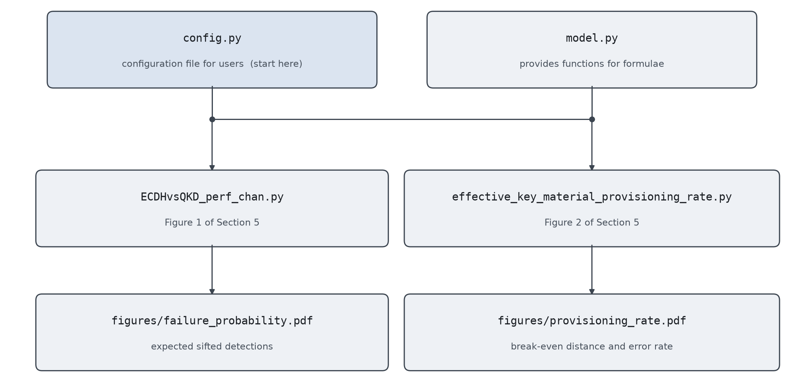

# Numerical Tools for ECDH vs. BB84

Numerical companion to our paper **A Unified Channel-Error Framework for Comparative Performance and Security Analysis
of Classical and Quantum Key Establishment**.
Reproduces the two figures and the break-even values reported in the paper.


## Motivation

ECDH and BB84 quantum key distribution both
establish shared key material; they are usually compared solely on the basis of their security guarantees. But another interesting factor to compare is how they degrade differently as a *communication channel* gets noisier.

This repo provides numerical tools that make the comparison concrete on a single shared channel model, parameterised by the channel error rate `eps_ch`, along two axes:

1. **Reliability:** ECDH must deliver a public key intact; a single flipped bit invalidates the exchange, so the failure probability grows with the key length `npk` unless a forward error-correcting code absorbs the errors. BB84 instead aborts when the observed QBER exceeds its security threshold. Figure 1 puts both failure modes on the same axis, for the NIST prime curves P-256/384/521, uncoded and under two codes.

2. **Key-Provisioning Behaviour:** Figure 2 compares the effective key-provisioning index
   `R_KP` of the two schemes: for ECDH, the security strength delivered per
   transported public-key bit, scaled by the channel capacity; for BB84, the
   asymptotic secret-key fraction scaled by the sifted detection yield, over a
   range of fibre lengths. Their crossing marks the regime where one scheme
   provisions key material faster than the other.


## Requirements

Python 3.10 or newer with NumPy, SciPy and Matplotlib.

```bash
python3 -m venv .venv
.venv/bin/pip install -r requirements.txt
```

`requirements.txt` pins the exact versions used to produce the published
figures (NumPy 2.5.3, SciPy 1.18.1, Matplotlib 3.11.1 on Python 3.14.4).


## Usage

```bash
.venv/bin/python ECDHvsQKD_perf_chan.py                     # Figure 1 of section 5
.venv/bin/python effective_key_material_provisioning_rate.py  # Figure 2 of section 5
```

Each script opens the figure and writes a vector copy to `figures/`:

| Script | Figure written | Also printed |
| --- | --- | --- |
| `ECDHvsQKD_perf_chan.py` | `figures/failure_probability.pdf` | expected number of sifted detections |
| `effective_key_material_provisioning_rate.py` | `figures/provisioning_rate.pdf` | break-even distance and break-even channel error rate |

`figures/` is regenerated on every run and is not tracked by git; drop the
entry from `.gitignore` to version the output alongside the source.


## Repository map



*Both scripts import both modules; neither contains a formula or a constant.*

| File | Role |
| --- | --- |
| `config.py` | **Every adjustable quantity.** Physical parameters, the curve and code tables, the sweep grids, which curves each figure draws, and the custom operating point. Start here. |
| `model.py` | The closed-form model: one function per formula, no state, no plotting. Imported by both scripts. |
| `ECDHvsQKD_perf_chan.py` | Figure 1: failure probability vs. channel error rate. |
| `effective_key_material_provisioning_rate.py` | Figure 2: provisioning rate vs. channel error rate, plus the break-even solver. |
| `requirements.txt` | Pinned dependency versions. |
| `docs/` | Architecture diagram above, and `make_architecture.py` that regenerates it. |

The two scripts contain no formulas and no constants: they select entries from
`config.py`, call `model.py`, and plot. Any change to the published figures is
therefore a change to `config.py` alone.


## Configuring a run

All edits happen in `config.py`, which is divided into commented sections.

- **Physical parameters**: `ETA_DET`, `PD`, `P_B`, `ALPHA`. These are the
  values behind the published figures.
- **Curves and codes**: `CURVES` maps a curve name to its security strength
  and uncompressed public-key length; `CODES` maps a (curve, code) pair to its
  `(n, k, t, number of codewords)`. Adding a row makes it available to both
  figures.
- **Curve selection**: `FIG1_UNCODED`, `FIG1_CODED`, `FIG2_CURVES`,
  `FIG2_DISTANCES_KM` list what each figure draws. Removing an entry drops the
  curve; no plotting code needs editing.
- **Custom operating point**: inputs to the break-even solver. This section
  is a scratch scenario and contributes no curve to Figure 2. It inherits the
  physical parameters above except where a line explicitly overrides one; at
  present only `ETA_DET_CUSTOM` (0.70) departs from the figure parameters
  (0.75). The two printed break-even values therefore describe a slightly more
  conservative detector than the plotted curves.


## Model

Implemented in `model.py`, one function per equation:

| Quantity | Function |
| --- | --- |
| Fibre transmittance `10^(-alpha d / 10)` | `transmittance` |
| Basis-match probability `p_B^2 + (1-p_B)^2` | `basis_match` |
| Sifted yield `p_BS (eta + (1-eta) p_d)` | `sifted_yield` |
| QBER `(eta e + (1-eta) p_d / 2) / (eta + (1-eta) p_d)` | `qber` |
| Binary entropy `H2` | `binary_entropy` |
| Secret-key fraction `max(0, 1 - 2 H2(Q))` | `secret_fraction` |
| BB84 rate | `rate_bb84` |
| ECDH rate `St / (2 npk) * (1 - H2(e))` | `rate_ecdh` |
| BB84 abort probability | `p_abort_bb84` |
| Uncoded public-key failure `1 - (1-e)^npk` | `p_fail_uncoded` |
| Coded public-key failure | `p_fail_coded` |
| Two-way exchange failure `1 - (1-p)^2` | `p_fail_exchange` |
